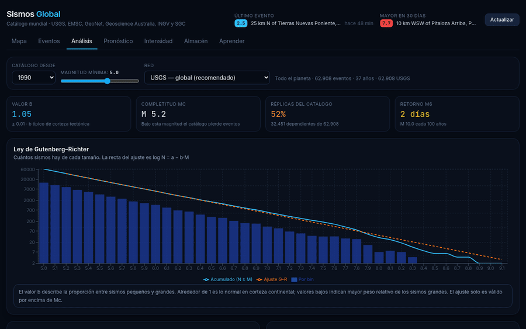
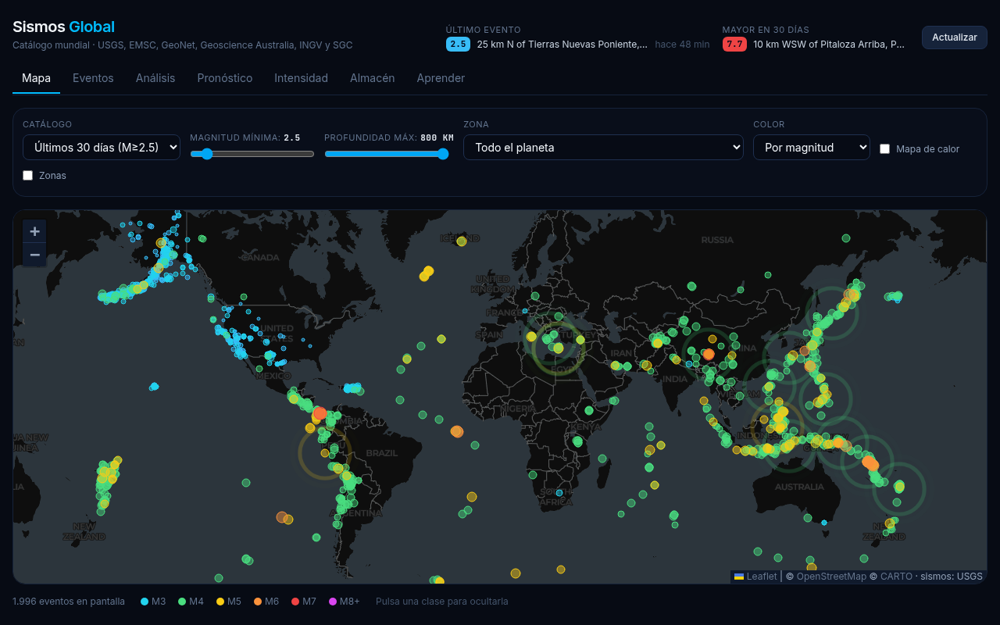
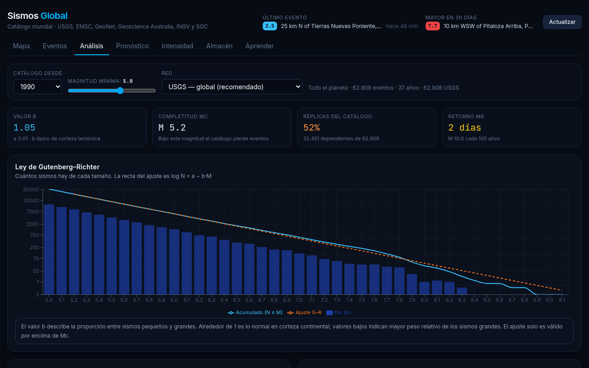
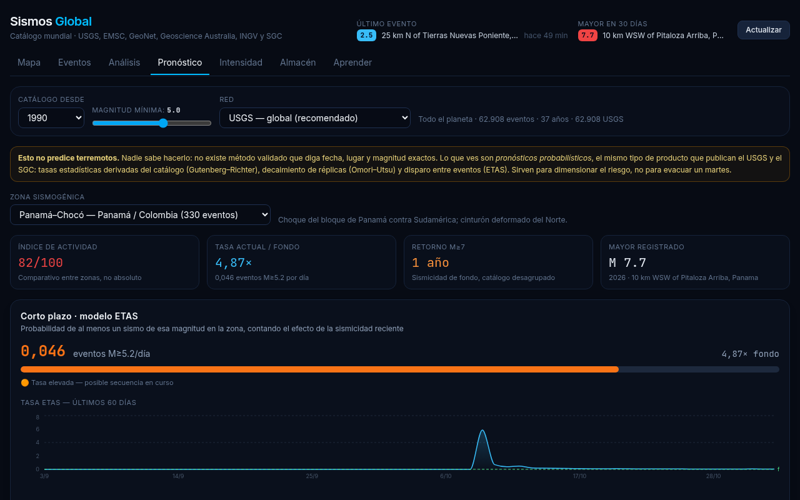

# Sismos Global

**English** · [Español](README.es.md)

> Global earthquake catalog, statistical analysis and probabilistic forecasting that runs entirely in your browser — no server, no remote database.

[](LICENSE)
[](https://github.com/Kromilla/sismos-global/actions/workflows/ci.yml)
[](https://sismos-global.vercel.app)

**Live demo → https://sismos-global.vercel.app**



## First things first

**This app does not predict earthquakes.** No validated method can. What it does is
**probabilistic forecasting** — the same kind of product published by the USGS and national
geological surveys: "in this zone, the probability of at least one M≥6 in the next 30 days is X%".
Every number on screen states the model used to compute it.

## Features

| Tab           | What it does                                                                                                                                      |
| ------------- | ------------------------------------------------------------------------------------------------------------------------------------------------- |
| **Map**       | Worldwide seismicity for the last 30 days or the historical catalog. Color by magnitude or depth, heatmap, 49 seismogenic zones.                  |
| **Events**    | Sortable catalog (magnitude, date, depth), energy released in TNT, estimated intensity (MMI) per city for each quake.                             |
| **Analysis**  | Gutenberg–Richter fit, b-value, magnitude of completeness, yearly activity, depth profile, hour of day.                                           |
| **Forecast**  | Short-term ETAS, long-term Poisson background, active aftershock sequences with Omori–Utsu, retrospective validation and ranking of the 49 zones. |
| **Intensity** | PSHA per city: hazard curve, design MMI and PGA (475 and 2475 years), magnitude–distance disaggregation and "what if…" scenarios.                 |
| **Warehouse** | DuckDB-WASM star schema loaded in the browser, SQL console with CSV export.                                                                       |
| **Learn**     | Regional tectonics, P/S waves, scales, what to do, myths debunked.                                                                                |

Data: multiple FDSN networks (USGS, EMSC, GeoNet, Geoscience Australia, INGV, GFZ, IPGP, SSN) plus
the Colombian Geological Survey (SGC), whose catalog goes back to **1610**.

## Models

All in `src/science/`, with no external math dependencies:

- **Gutenberg–Richter** (`gutenbergRichter.ts`) — maximum-likelihood b-value (Aki 1965), error after Shi & Bolt (1982), Mc by maximum curvature.
- **Declustering** (`declustering.ts`) — Gardner & Knopoff (1974) space–time windows.
- **Omori–Utsu** (`omori.ts`) — MLE fit, Reasenberg & Jones (1989) generic model, Båth's law.
- **ETAS** (`etas.ts`) — simplified temporal Ogata (1988).
- **PSHA** (`psha.ts`) — point-source hazard from the declustered catalog, runs in a Web Worker (`psha.worker.ts`).
- **Intensity** (`intensity.ts`) — Allen, Wald & Worden (2012) and Atkinson & Wald (2007) IPEs, Worden et al. (2012) MMI↔PGA.

See [README.es.md](README.es.md) for the full methodology, reference timings and known limitations.

## Screenshots

| Map                              | Analysis                                    | Forecast                                   |
| -------------------------------- | ------------------------------------------- | ------------------------------------------ |
|  |  |  |

## Quick start

```bash
npm install
npm run dev      # http://localhost:5173
npm test         # vitest
npm run build    # static build in dist/
```

Stack: React 19 · TypeScript · Vite · Tailwind 4 · Leaflet · Recharts · DuckDB-WASM.

## Known limitations

- The IPEs are not calibrated for Andean subduction; hazard values are comparative and **do not replace building codes** (e.g. NSR-10).
- PSHA ignores site effects (soil type).
- ETAS is calibrated by branching ratio, not full maximum likelihood.

## Contributing

Contributions are welcome — see [CONTRIBUTING.md](CONTRIBUTING.md) and the
[good first issues](https://github.com/Kromilla/sismos-global/labels/good%20first%20issue).

## License

[MIT](LICENSE)
